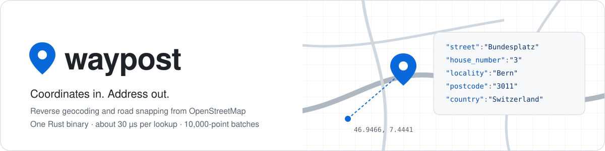
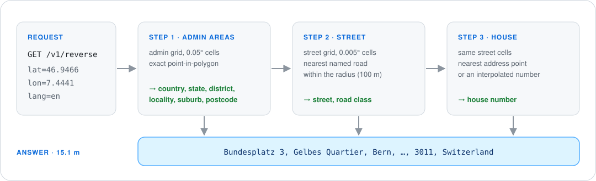

<p align="center">
  
</p>

<p align="center">
  <a href="https://github.com/yar1k0v/waypost/actions/workflows/ci.yml"></a>
  <a href="#license"></a>
  
  
</p>

waypost turns coordinates into addresses, and snaps them to the nearest road. It runs on your own machine from OpenStreetMap data, with no external API and no per-request fees.

- **Fast:** about 30 µs per lookup on one thread, and about 58,000 points per second in batches of up to 10,000 (Switzerland, one desktop machine).
- **Exact:** admin borders keep every vertex and every hole. No simplified polygons.
- **Multilingual:** answers in any language OSM has, for example `de`, `fr`, `it`, `en`.
- **Small:** one index file. Switzerland takes 369 MB on disk. The server maps it, so its RAM is about the file size.
- **Easy to run:** `docker compose up` builds the index and starts the server.
- **Checked:** CI compares 10,000 answers of the old and new code on every pull request.

## Quick start

Needs Docker.

```sh
git clone https://github.com/yar1k0v/waypost && cd waypost
docker compose up -d
```

The first run downloads Switzerland (550 MB), then builds the index in about 2 minutes. Later runs reuse it.

```sh
curl 'http://127.0.0.1:8088/v1/reverse?lat=46.9466&lon=7.4441&lang=en'
```

```json
{
  "match": "address",
  "distance_m": 15.1,
  "address": {
    "house_number": "3",
    "street": "Bundesplatz",
    "suburb": "Gelbes Quartier",
    "locality": "Bern",
    "district": "Bernese Mittelland administrative region",
    "state": "Bern",
    "postcode": "3011",
    "country": "Switzerland",
    "country_code": "CH"
  },
  "display": "Bundesplatz 3, Gelbes Quartier, Bern, Bernese Mittelland administrative region, Bern, 3011, Switzerland",
  "source": { "osm_type": "way", "osm_id": 254958900, "data_date": "2026-11-08T21:21:00Z" }
}
```

With `lang=fr`, the same point answers `Berne`, `Quartier jaune` and `Suisse`.

### Your countries

Edit `waypost.env`, then run `docker compose up -d --force-recreate`. The index rebuilds by itself. The images stay as they are.

```sh
PBF_URLS=https://download.geofabrik.de/europe/austria-latest.osm.pbf https://download.geofabrik.de/europe/germany-latest.osm.pbf
WAYPOST_LANGS=en,de
```

Extracts: [download.geofabrik.de](https://download.geofabrik.de/). All settings: [docs/operations.md](docs/operations.md#run-with-docker-compose).

## How it works


One lookup reads a few grid cells of the memory-mapped index. Threads share it without locks.



Details: [docs/architecture.md](docs/architecture.md).

## API

| Endpoint | Returns |
|---|---|
| `GET /v1/reverse` | Address of one point |
| `POST /v1/reverse/batch` | Addresses of up to 10,000 points, in input order |
| `GET /v1/snap` | Nearest road point, with road name, class and maxspeed |
| `POST /v1/snap/batch` | Up to 10,000 snapped points |
| `GET /reverse`, `GET /snap` | Legacy-compatible routes for existing clients |
| `GET /v1/info` | Index sources, OSM data date, languages |
| `GET /healthz`, `/readyz`, `/metrics` | Liveness, readiness, Prometheus metrics |

Parameters, responses and errors: [docs/api.md](docs/api.md).

⚠ waypost has no authentication. Keep the port on a private network, or put an authenticating proxy in front.

## Development

Needs Rust 1.98+. Build from source and run without Docker: [docs/operations.md](docs/operations.md#build-from-source).

```sh
cargo fmt --all && cargo clippy --all-targets -- -D warnings && cargo test
```

| Path | Contents |
|---|---|
| `crates/waypost-core` | Index format, geometry, exact point-in-polygon, lookups |
| `crates/waypost-builder` | CLI: prepared OSM extracts → index file |
| `crates/waypost-server` | HTTP API |
| `scripts/` | osmium data preparation and the index build entrypoint |
| `tools/` | Test point generator and accuracy comparison (Python, stdlib only) |
| `docker/`, `compose.yaml`, `waypost.env` | Images, compose setup and its settings |

Releases: push a tag `vX.Y.Z`. CI publishes `ghcr.io/yar1k0v/waypost-server` and `ghcr.io/yar1k0v/waypost-builder`.

## License

Code: [MIT](LICENSE-MIT) or [Apache-2.0](LICENSE-APACHE), at your option.

Map data © [OpenStreetMap contributors](https://www.openstreetmap.org/copyright), under the [Open Database License](https://opendatacommons.org/licenses/odbl/). An index built from OSM data is a derived database under the same license.
