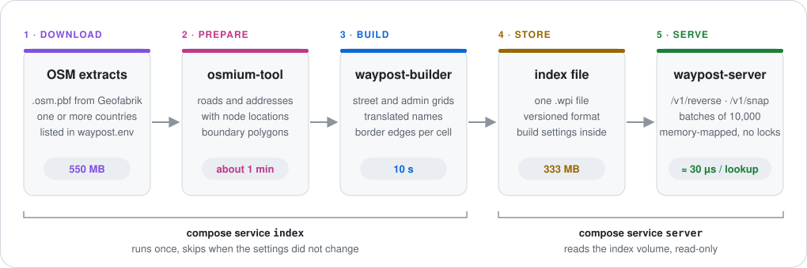

# waypost

Reverse geocoding and road snapping for fleet services, in one Rust binary. Send coordinates, get back a house number, street, locality, district, state and country, or the nearest point on a road.



| | |
|---|---|
| **Fast** | One memory-mapped index, lock-free reads, about 18 µs per lookup, batches of 10,000 points |
| **Exact** | Admin borders keep every vertex and every hole. Inside/outside uses integer arithmetic, not simplified polygons |
| **Multilingual** | Names from `name:<lang>` (for example `de`, `fr`, `it`, `en`), with fallback to `name` |
| **Easy to run** | `docker compose up` builds the index and starts the server. Countries are set in one config file |
| **Small to run** | One binary per role. The Switzerland index is 333 MB, and the server needs about 325 MB of RAM |
| **Safe to rebuild** | The index carries its build settings and format version. The server refuses a file it cannot read |
| **Tested on real answers** | CI runs 10,000 points on the old and new code and fails above 0.5% change per field |

## Quick start

Needs Docker.

```sh
git clone https://github.com/yar1k0v/waypost && cd waypost
docker compose up -d
```

The first run downloads Switzerland (550 MB), then builds the index in about 2 minutes. Later runs reuse it.

```sh
curl 'http://127.0.0.1:8088/v1/reverse?lat=46.9466&lon=7.4441&lang=en'
```

```json
{"match":"address","distance_m":15.1,
 "address":{"house_number":"3","street":"Bundesplatz","suburb":"Gelbes Quartier",
            "locality":"Bern","district":"Bernese Mittelland administrative region",
            "state":"Bern","postcode":"3011","country":"Switzerland","country_code":"CH"},
 "display":"Bundesplatz 3, Gelbes Quartier, Bern, Bernese Mittelland administrative region, Bern, 3011, Switzerland"}
```

With `lang=fr`, the same point answers `Berne`, `Quartier jaune` and `Suisse`.

### Other countries

Edit `waypost.env`, then run `docker compose up -d --force-recreate`. The index rebuilds by itself. No image rebuild.

```sh
PBF_URLS=https://download.geofabrik.de/europe/austria-latest.osm.pbf https://download.geofabrik.de/europe/germany-latest.osm.pbf
WAYPOST_LANGS=en,de
```

Extract list: [download.geofabrik.de](https://download.geofabrik.de/). Building from source: [docs/operations.md](docs/operations.md#build-from-source).

## Endpoints

| Endpoint | Purpose |
|---|---|
| `GET /v1/reverse` | Address of one point |
| `POST /v1/reverse/batch` | Addresses of up to 10,000 points, in input order |
| `GET /v1/snap` | Nearest road point, with road name, class and maxspeed |
| `POST /v1/snap/batch` | Snap up to 10,000 points |
| `GET /reverse`, `GET /snap` | Legacy-compatible routes for existing clients |
| `GET /v1/info` | Index sources, data date, languages |
| `GET /healthz`, `/readyz`, `/metrics` | Liveness, readiness, Prometheus |

Full reference: [docs/api.md](docs/api.md).

⚠ The service has no authentication. Keep the port on a private network, or put an authenticating proxy in front.

## Docs

| Doc | Answers |
|---|---|
| [docs/architecture.md](docs/architecture.md) | How the parts fit, how a lookup works, the index format |
| [docs/api.md](docs/api.md) | Every endpoint, parameter, response and error |
| [docs/operations.md](docs/operations.md) | Settings, building from source, sizing, accuracy checks, releases |

## Repository

| Path | Contents |
|---|---|
| `crates/waypost-core` | Index format, geometry, exact point-in-polygon, lookups |
| `crates/waypost-builder` | CLI: prepared OSM extracts → index file |
| `crates/waypost-server` | HTTP API |
| `scripts/` | osmium data preparation and the index build entrypoint |
| `tools/` | Test point generator, comparison and accuracy gate (Python, stdlib) |
| `docker/`, `compose.yaml`, `waypost.env` | Images, compose setup and its settings |

## Checks

```sh
cargo fmt --all && cargo clippy --all-targets -- -D warnings && cargo test
```

Release: push a tag `vX.Y.Z`. CI publishes `ghcr.io/yar1k0v/waypost-server` and `waypost-builder` images.

## License

Code: [MIT](LICENSE-MIT) or [Apache-2.0](LICENSE-APACHE), at your option.

Map data © OpenStreetMap contributors, under the [Open Database License](https://opendatacommons.org/licenses/odbl/). An index built from OSM data is a derived database under the same license.
