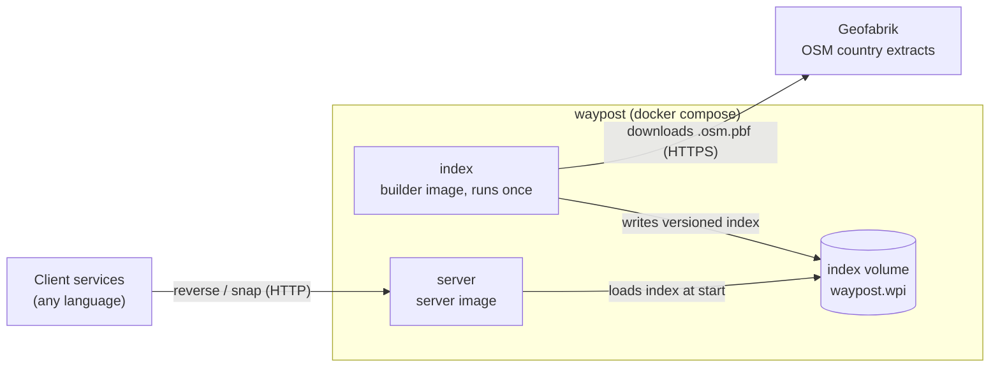
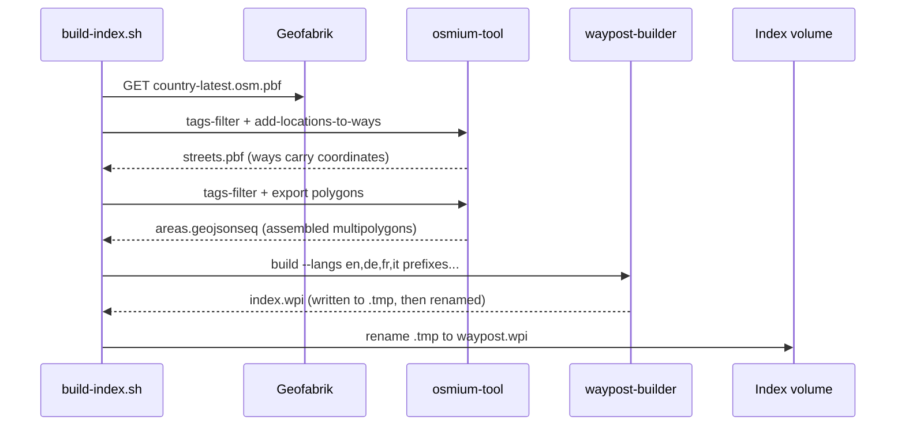
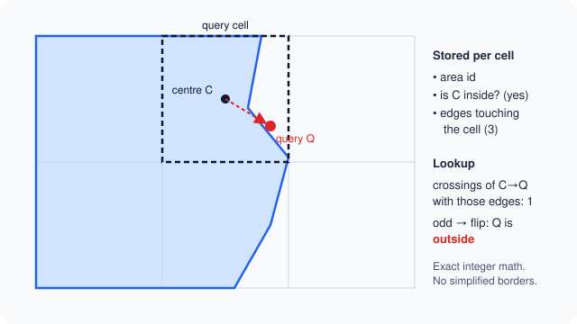

# Architecture

## Context



| Part | Runs as | Does |
|---|---|---|
| waypost-builder | `index` service, builder image | Downloads extracts, prepares them with osmium-tool, writes one index file |
| Index volume | Docker volume `index` | Holds `waypost.wpi` and the settings it was built from |
| waypost-server | `server` service, server image | Memory-maps the index and answers HTTP lookups |
| waypost-core | Rust library | Index format, geometry and lookups, shared by builder and server |

## Index build



- osmium-tool assembles multipolygons and attaches node locations. The Rust builder never holds a planet-size node table.
- Several countries go into one index: pass several prefixes to the builder.
- Switzerland (2026-11-08): about 1 minute of osmium prep, 10 seconds of build, a 333 MB index.

## Lookup

One lookup reads a few grid cells. No locks: the index is immutable and shared by all threads.

| Step | Grid | Finds |
|---|---|---|
| Admin areas | Admin grid (0.05°) | Country, state, district, locality, suburb, postcode |
| Street | Street grid (0.005°) | Nearest named road within the radius |
| Houses | Street grid | Nearest address point or interpolated number |
| Settlement | Admin grid | Nearest `place=*` node when no area names the locality |

Street rule (`street=hybrid`, default): the nearest road names the street, unless a house is closer than every road (a vehicle parked in a yard). Then that house's street and number win. `street=road` always uses the road and takes a house number only from a house on that road.

### Exact admin areas



Per admin cell the index stores, for each area that touches it, whether the cell centre is inside and which border edges touch the cell. A lookup counts how often the segment from the centre to the query point crosses those edges. An odd count flips the centre's answer. The segment stays inside the cell, so every edge it can cross is in the list.

- Borders are never simplified. Holes and enclaves stay correct.
- All predicates use integer arithmetic on fixed-point coordinates, so the builder and the server always agree.
- A fuzz test checks the cell method against a full polygon test on random polygons.

### Distances

Coordinates are `i32` in units of 1e-7 degrees. Distances are metres in a local metric frame centred on the query point; the error stays under 0.5% within 5 km. One distance function serves the whole codebase.

## Index file

```text
[0..8)    magic "WAYPOST\0"
[8..12)   format version (u32)
[12..16)  reserved
[16..24)  metadata offset (u64)
[24..32)  metadata length (u64)
[32..)    sections, each 8-byte aligned
[meta)    JSON: build settings, sources, data date, section table
```

| Section | Records |
|---|---|
| `strings`, `names`, `name_alts` | Deduplicated UTF-8 strings and translated names |
| `nodes`, `ways`, `pieces` | Road geometry; a piece is at most 16 segments of one way |
| `addrs`, `interps`, `places` | Address points, interpolation ways, settlement nodes |
| `areas`, `area_points`, `area_edges`, `area_cells` | Admin, place and postcode polygons and their per-cell edges |
| `*_grid`, `*_ids` | Sorted cell tables pointing at record ids |

- Record layouts live in `crates/waypost-core/src/model.rs` and are the file format. A layout change needs a new `FORMAT_VERSION`.
- The server takes every build setting (cell sizes, languages) from the metadata. It validates all offsets at load, so a damaged file fails at start, never during a request.
- The builder writes `<file>.tmp` and renames it. A crash never leaves a partial index under the final name.
